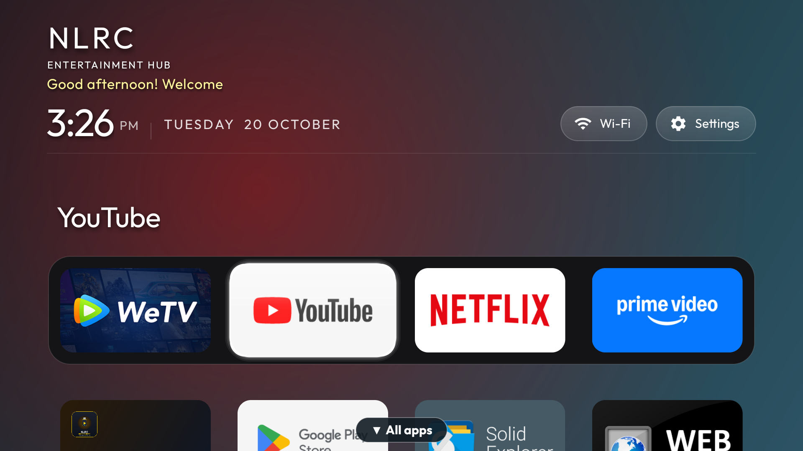
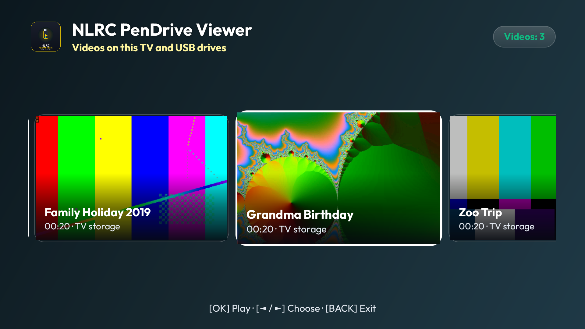
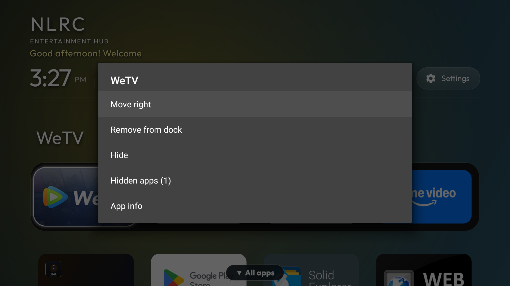
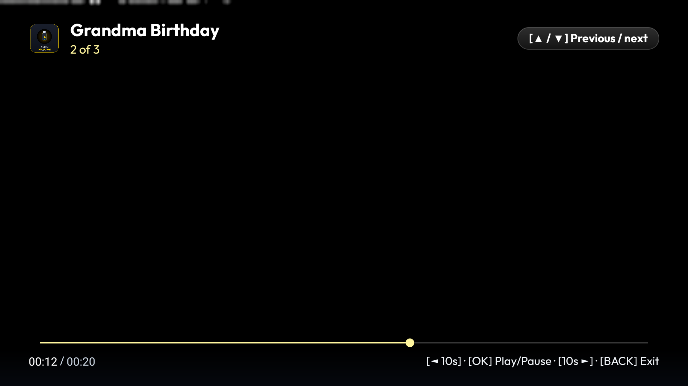
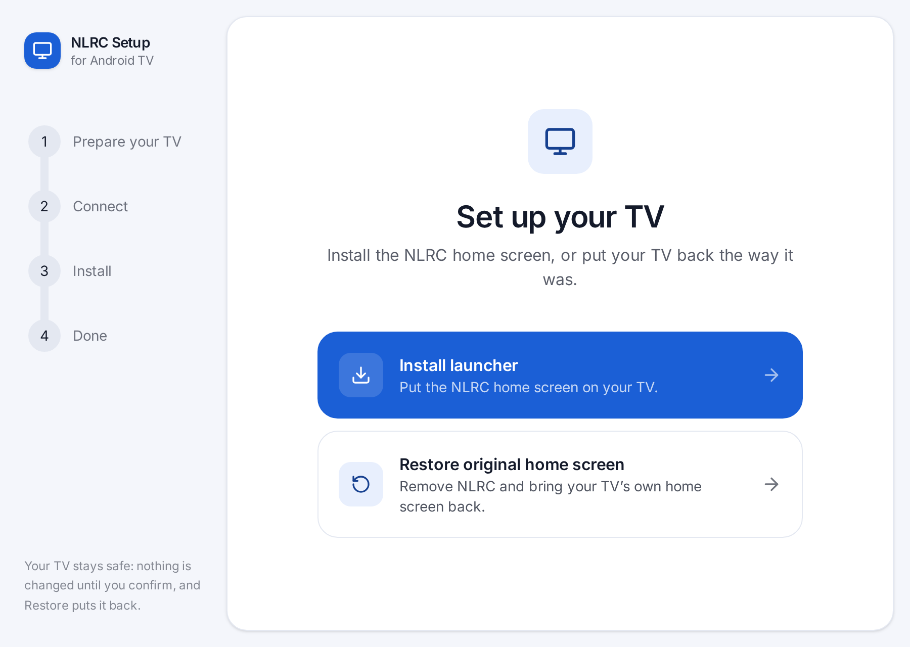
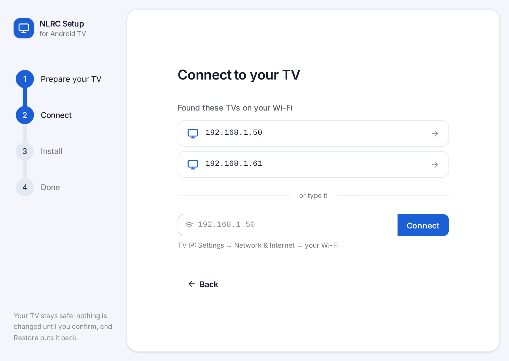
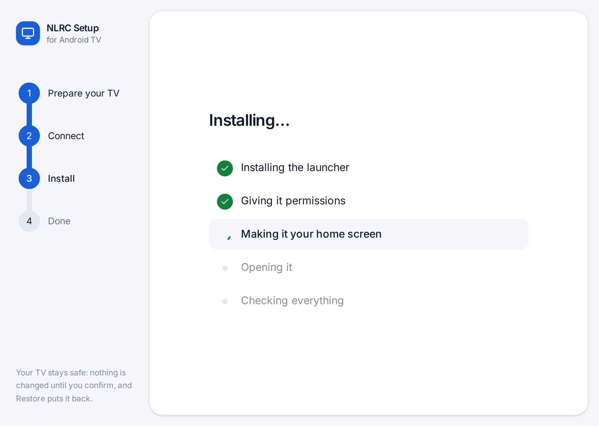
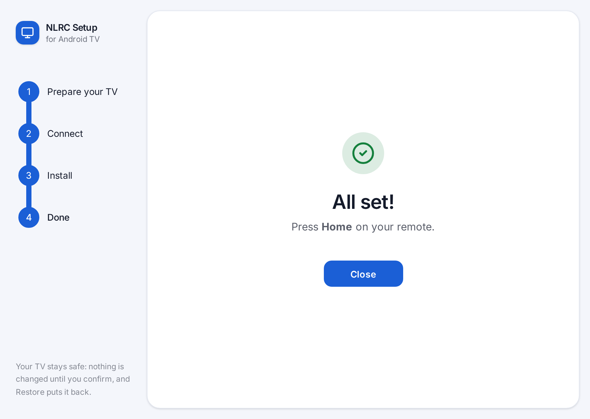

# tv-vibehack 📺✨

> **Transform any ad-bloated Android TV or Google TV into a lightning-fast, tvOS-inspired, fail-safe experience — without root, without bootloop risks, and without losing access to stock features.**

[-green.svg)](https://developer.android.com/about/versions/14)
[](LICENSE)
[](#)
[](#the-100-fail-safe-architecture)

---

## 📐 Architecture & Transformation Overview

```text
[ STOCK GOOGLE TV ]                             [ NLRC TV VIBEHACK ]
┌──────────────────────────────────────┐        ┌──────────────────────────────────────┐
│  Sponsored Ad Banner (70% Screen)    │        │  NLRC Home · Ambient Clock & Date    │
│  [Trending Shows] [Paid Promotions]  │        │                                      │
│  50+ Bloatware OTT Apps              │   ➔    │                                      │
│  Remote Buttons Lock You In Paywalls │        │  Dock: [HDMI 2 (Cable)] [Media Vault]│
└──────────────────────────────────────┘        └──────────────────────────────────────┘
   • 2.5 GB RAM used                               • 120 MB RAM used
   • Heavy telemetry & tracking                    • 0 Ads · 0 Telemetry · 100% Fail-Safe
```

---

## 🖼️ Preview

| Home screen | PenDrive Viewer |
|---|---|
|  |  |
| **Dock menu (hold OK)** | **Video player** |
|  |  |

---

## 🎯 The Motivation

Modern Smart TVs ship with:
- **Sponsored ads covering 70% of the screen**.
- **Sluggish bloatware** and 50+ pre-installed background apps consuming memory and tracking habits.
- **Unremappable sponsored remote buttons** (Netflix, Prime Video) that elderly family members hit by mistake, throwing them into subscription walls.
- **Overly complicated navigation** that makes switching to Cable/HDMI or playing personal home videos a headache.

**tv-vibehack** solves this permanently. Originally built to give aging parents a distraction-free, one-touch TV experience, it provides a universal blueprint for taking back control of any Android TV without root.

---

## ⚡ What Makes This Different?

### 1. 🛡️ The 100% Fail-Safe Architecture (Zero Bootloops)
On Android 14 Google TV, disabling the stock launcher (`com.google.android.apps.tv.launcherx`) breaks Direct Boot, tripping Android's `RescueParty` service and bricking the TV into a black-screen recovery state.

**tv-vibehack never disables `launcherx`.** Instead:
- The custom launcher is **`directBootAware="true"`**.
- A lightweight native **Accessibility Service** (`HomeKeyService`) intercepts Home key events and window transitions in under 10ms.
- If the custom launcher is ever uninstalled or crashes, Google TV seamlessly takes over. **Zero chance of bricking your TV.**

### 2. 🔀 Hardware Passthrough (Direct HDMI Switching)
No more opening 4 nested TV menus just to watch cable. Through reverse-engineered Realtek RTD `TvContract` passthrough URIs, the launcher switches directly to HDMI inputs programmatically:
```java
Uri uri = TvContract.buildChannelUriForPassthroughInput(
    "com.realtek.tv.passthrough/.hdmiinput.HDMITvInputService/HW151519744" // HDMI 2
);
context.startActivity(new Intent(Intent.ACTION_VIEW, uri));
```

### 3. 🎮 Sponsored Remote Key Remapping (No Root)
`HomeKeyService` intercepts hardcoded hardware remote buttons (`KEYCODE_BUTTON_3` for Netflix, `KEYCODE_BUTTON_4` for Prime Video, `KEYCODE_PROG_RED`/`GREEN`) and redirects them straight to HDMI 2 / Set-Top Box in <150ms without root.

The redirect only runs on TVs that actually have that HDMI 2 input (`HdmiHelper.isAvailable()`). Everywhere else, Netflix and Prime Video open normally.

### 4. 🎞️ PenDrive Viewer (Your Own Videos)
Lists every video it finds on the TV and on plugged-in USB drives, with a real thumbnail, name, duration and source. There's no fixed number of "parts": add or remove files and the list follows.

It looks in `Movies/`, `Download/` and `Movies/NLRC/` on TV storage, plus the top level and `Movies/` of each USB drive. The first time you open it, allow storage access.

#### How to Add Your Own Media:
1. **Transcode old formats (e.g. DVD MPEG-2) to H.264**, which every TV chipset decodes:
   ```bash
   ffmpeg -i "Holiday.vob" -c:v libx264 -preset faster -crf 23 -c:a aac -b:a 192k "Family_Holiday_2019.mp4"
   ```
   The file name becomes the title: `Family_Holiday_2019.mp4` shows as "Family Holiday 2019".
2. **Copy it to the TV**, or just copy it onto a USB stick and plug it in:
   ```bash
   adb push Family_Holiday_2019.mp4 /sdcard/Movies/
   ```
3. **Play from the remote:**
   - OK: Play / Pause.
   - ◄ / ►: Seek -10s / +10s.
   - ▲ / ▼ or CH+ / CH-: Previous / next video. Playback continues to the next video on its own.

### 5. 📌 Dock You Edit From the Remote
Hold **OK** on any tile for a menu:
- **Pin to dock** / **Remove from dock**.
- **Move left** / **Move right** to reorder the dock.
- **Hide**, and **Hidden apps** to bring them back.
- **App info**.

Choices are saved on the TV and survive reboots and app updates.

### 6. 🌐 11 Languages, No Religion, No Festivals
The launcher follows the TV's language: English, Portuguese, Spanish, French, Italian, German, Dutch, Russian, Chinese (Simplified), Telugu and Hindi. The home screen shows a simple time-of-day greeting ("Good morning! Welcome") with the clock and date. Unsupported languages fall back to English.

---

## 🖱️ Easy install (no coding)

No terminal needed. Download the **NLRC Setup** app, point it at your TV, and it does the rest. Tested on a Xiaomi Mi Box (Android 9).

1. Open the project's **Releases** page on GitHub and download the file for your computer (available once the first release is published):
   - **Windows:** the `.exe` or `.msi` installer
   - **Mac:** the `.dmg`
   - **Linux:** the `.AppImage` or `.deb`
2. On the TV, open Settings → System → About and click **Build** 7 times, then in Developer Options turn on **USB debugging** (and **Network debugging** if you see it). Make sure the computer and the TV are on the same Wi-Fi.
3. Open NLRC Setup, type the TV's IP address (port 5555), accept the prompt that appears on the TV, and follow the steps.

| Pick what to do | Find your TV |
|---|---|
|  |  |
| **Install, step by step** | **Done** |
|  |  |

The app works out the right way to make the launcher your home screen for your TV by itself (the Android 14 Google TV way or the Android 9 way), and tells you up front if your TV isn't supported yet. It only works with TVs it can reach over the network. USB is not supported.

The app speaks the same 11 languages as the launcher and follows your computer's language.

Changed your mind? The **Restore** option puts the TV back to how it was and removes the launcher.

**First time you open it:** the app isn't signed with a paid developer certificate, so your computer will warn you.
- **Windows:** click **More info**, then **Run anyway**.
- **Mac:** if it says the app can't be opened, go to **System Settings → Privacy & Security** and click **Open Anyway** (on older macOS: right-click the app and choose **Open**).

Prefer to do it by hand? The **Quick Start** below is the manual alternative. Want to work on the app itself? See [`installer/README.md`](installer/README.md).

---

## 🚀 Quick Start

### 1. Enable ADB on your Android TV
1. On the TV: **Settings** → **System** → **About** → Click **Build** 7 times to enable Developer Options.
2. Go to **Settings** → **System** → **Developer Options** → Turn on **USB Debugging** (and Network Debugging if available).
3. Connect your computer to the same Wi-Fi network as the TV.

### 2. Connect via ADB
```bash
adb connect <TV_IP_ADDRESS>:5555
```
Accept the *"Always allow from this computer"* dialog on your TV.

### 3. Safe Debloat
Safely disable ad-trackers and bloatware using model-specific profiles:
```bash
# Example for Acer / Realtek QLED Android 14 TVs
adb shell pm disable-user --user 0 com.google.android.tvrecommendations
```
*(See [`examples/`](examples/) for model-specific profiles).*

### 4. Build & Install the Launcher
Needs JDK 17 and the Android SDK (point `JAVA_HOME` at JDK 17 if your default Java is different). More build details in [`launcher/README.md`](launcher/README.md).
```bash
cd launcher
./gradlew assembleDebug
adb -s <TV_IP_ADDRESS>:5555 install -r app/build/outputs/apk/debug/app-debug.apk
```
Pass `-s` whenever a phone is also plugged in, or adb stops with "more than one device".

If the install fails with "not enough space", run `adb shell pm trim-caches 999G` to clear app caches. If it stalls partway on weak Wi-Fi, copy the APK onto a USB stick and install it from the TV's file app.

### 5. Make It the Home Screen
**Android 14 Google TV:** enable the accessibility interceptor. Never disable the stock launcher here.
```bash
adb shell settings put secure enabled_accessibility_services com.gathin.tvhome/.HomeKeyService
adb shell settings put secure accessibility_enabled 1
```

**Android 9–11 (e.g. Xiaomi Mi Box 3, Mi TV):** the interceptor doesn't apply. Disable the stock launcher instead; this is safe on these versions and can be undone:
```bash
adb shell pm disable-user --user 0 com.google.android.tvlauncher
# undo: adb shell pm enable com.google.android.tvlauncher
```

---

## 📁 Repository Structure

| Path | Description |
|---|---|
| [`launcher/`](launcher/) | Native Android TV launcher with Apple tvOS aesthetics, D-pad navigation, ambient glow, and Direct Boot awareness. Build notes in [`launcher/README.md`](launcher/README.md). |
| [`launcher/.../HomeKeyService.java`](launcher/app/src/main/java/com/gathin/tvhome/HomeKeyService.java) | Fail-safe Accessibility Service intercepting Home button and sponsored hotkeys. |
| [`launcher/.../HdmiHelper.java`](launcher/app/src/main/java/com/gathin/tvhome/HdmiHelper.java) | Direct Realtek / Android TV hardware passthrough input launcher. |
| [`launcher/.../AppAdapter.java`](launcher/app/src/main/java/com/gathin/tvhome/AppAdapter.java) | App and input tiles, plus the hold-OK menu to pin, reorder and hide tiles. |
| [`launcher/.../PenDriveActivity.java`](launcher/app/src/main/java/com/gathin/tvhome/PenDriveActivity.java) | Finds videos on TV storage and USB drives and lists them with thumbnails. |
| [`launcher/.../VideoPlayerActivity.java`](launcher/app/src/main/java/com/gathin/tvhome/VideoPlayerActivity.java) | Full-screen player with remote seek HUD and previous / next video. |
| [`launcher/.../Fonts.java`](launcher/app/src/main/java/com/gathin/tvhome/Fonts.java) | Re-applies font weights on Android 9, where the variable Outfit font otherwise renders Thin. |
| [`launcher/app/src/main/res/values*/`](launcher/app/src/main/res/) | UI text in 11 languages (`strings.xml` per language). |
| [`examples/acer-v-pro-32-qled/`](examples/acer-v-pro-32-qled/) | Comprehensive teardown and architecture notes for Acer / MOKA Realtek RTD QLED TVs. |
| [`installer/`](installer/) | **NLRC Setup**, the desktop app (Windows, macOS, Linux) that installs the launcher over Wi-Fi with no terminal. Tauri + Rust backend, Svelte + daisyUI screens. See [`installer/README.md`](installer/README.md). |
| [`.github/workflows/installer-release.yml`](.github/workflows/installer-release.yml) | On a `setup-v*` tag: builds the signed launcher APK and the NLRC Setup downloads, then drafts a GitHub Release. |
| [`tools/`](tools/) | Helper scripts: `safe_switch.bat` / `safe_switch.sh` for one-click toggle between stock and custom launcher. |

---

## 📖 Deep Dive Hardware Case Studies
- [Acer V Pro 32" QLED (Android 14 API 34, Realtek RTD, MOKA R3G)](examples/acer-v-pro-32-qled/README.md)
- [Xiaomi Mi TV 4A (PatchWall Debloat)](examples/xiaomi-mi-tv-4a/README.md)

---

## 🤝 Contributing
Contributions are warmly welcomed! If you've reverse-engineered input IDs or debloat profiles for your specific TV brand (TCL, Sony Bravia, Hisense, OnePlus, Nvidia Shield), please submit a pull request under [`examples/`](examples/).

See [CONTRIBUTING.md](CONTRIBUTING.md) for details.

---

## 📄 License
This project is licensed under the [MIT License](LICENSE).
Outfit typeface licensed under SIL Open Font License.
